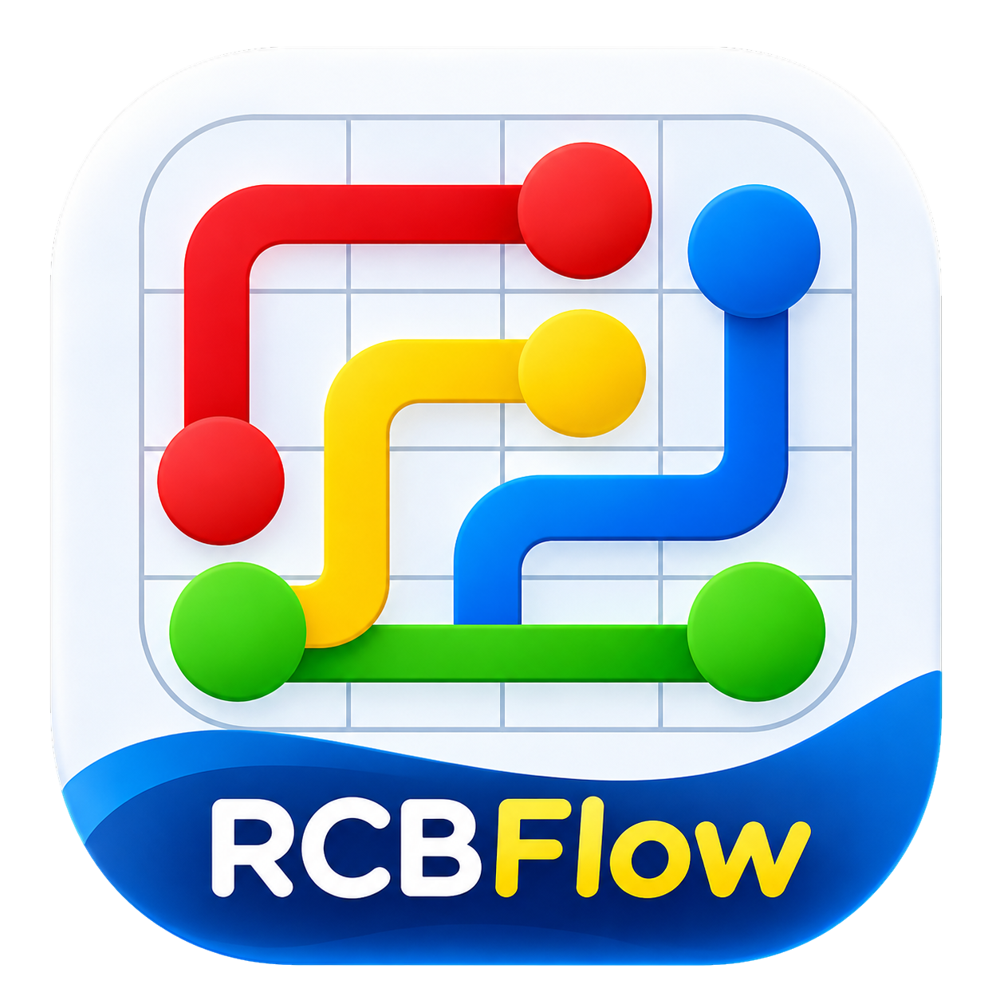
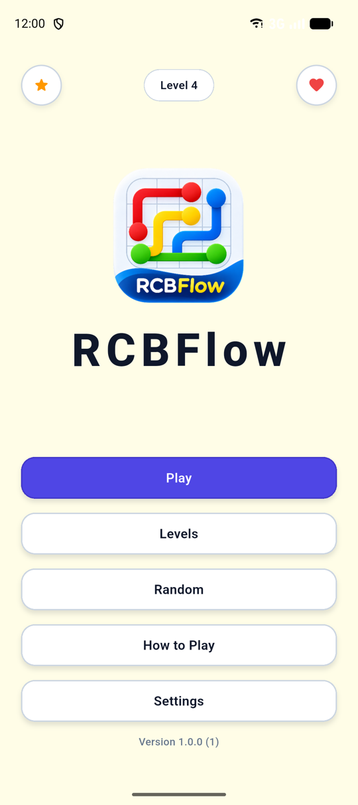
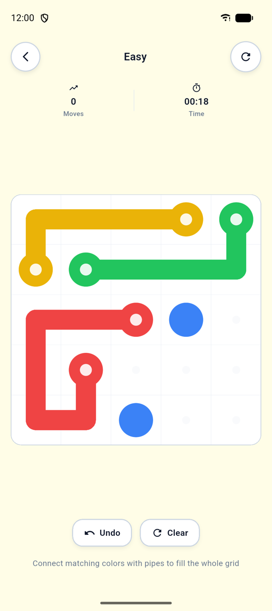
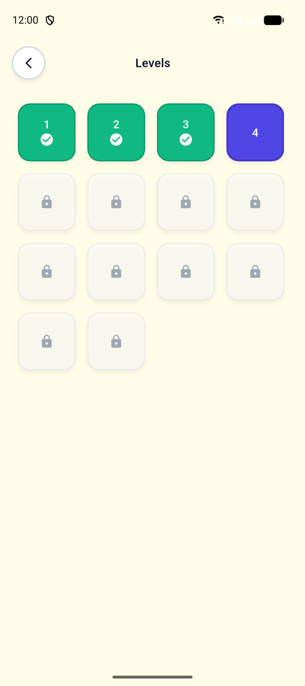
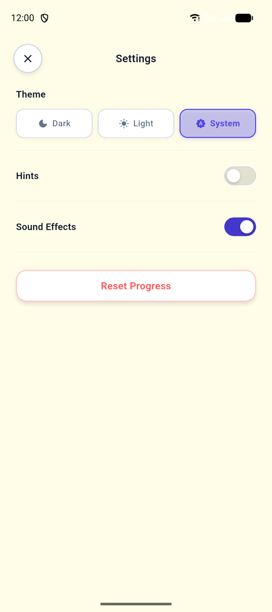
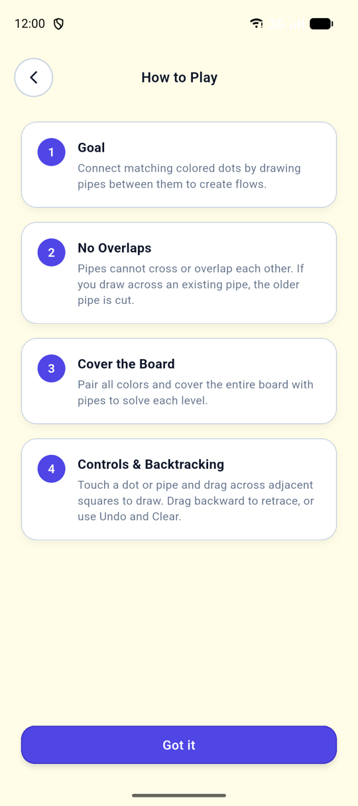

<p align="center">
  
</p>

<h1 align="center">RCBFlow</h1>

<p align="center">
  A personal, independently branded fork of the open-source
  <a href="https://github.com/sidhant947/Flow">Flow</a> puzzle game.<br />
  Same connect-the-colours gameplay, with its own branding and a test suite.
</p>

<p align="center">
  <a href="https://flutter.dev"></a>
  <a href="https://dart.dev"></a>
  
  <a href="LICENSE"></a>
  <a href="https://github.com/Rananjaya/RCBFlow"></a>
</p>

## About

RCBFlow is a logic puzzle: draw pipes to join dots of the same colour, without
crossing, until every cell on the board is filled. It runs fully offline and
keeps your progress on the device.

It is based on [Flow by sidhant947](https://github.com/sidhant947/Flow). The
gameplay comes from that project. This fork adds its own branding, privacy
cleanups and automated tests. RCBFlow is a personal project, maintained
independently, and is not affiliated with or endorsed by the original author.

## Screenshots

<table>
  <tr>
    <td align="center"><br /><sub>Home</sub></td>
    <td align="center"><br /><sub>Gameplay</sub></td>
    <td align="center"><br /><sub>Levels</sub></td>
  </tr>
  <tr>
    <td align="center"><br /><sub>Settings</sub></td>
    <td align="center"><br /><sub>How to Play</sub></td>
    <td></td>
  </tr>
</table>

## Features

- Connect matching coloured dots; crossing an existing pipe cuts it.
- Level progression from 5×5 up to 14×14 boards, with levels unlocked as you go.
- Random mode with five difficulties (Easy to Master).
- Undo, clear, restart, move counter and timer.
- Optional hints that reveal one pipe from the solution.
- Progress, best moves/times and unfinished boards saved locally.
- Light, dark and system themes; sound effects toggle.
- Works offline. The release build requests no internet permission.

## Technology

[Flutter](https://flutter.dev) and Dart, targeting Android. State is managed with
[Riverpod](https://riverpod.dev) and stored locally with [Hive](https://pub.dev/packages/hive).

## Build and run

```bash
flutter pub get              # install dependencies
flutter analyze              # static analysis
flutter test                 # run the test suite
flutter run                  # run on a connected device or emulator
flutter build apk --debug    # debug APK
flutter build apk --release  # release APK
```

APKs are written to `build/app/outputs/flutter-apk/`. For details, see:

- [DEVELOPMENT.md](DEVELOPMENT.md): setup, architecture and project layout
- [TESTING.md](TESTING.md): how the tests are organised
- [RELEASE.md](RELEASE.md): versioning, signing and release checklist
- [PRIVACY_AND_SECURITY.md](PRIVACY_AND_SECURITY.md): data handling and rules for new features

## Credits

- **Original project:** [Flow](https://github.com/sidhant947/Flow) by
  [sidhant947](https://github.com/sidhant947). The gameplay, level generator,
  UI and sound effects come from that project, which remains the work of its
  author. Upstream AI-use declaration: [AI-DECLARATION.md](AI-DECLARATION.md).
- **This fork:** [Rananjaya/RCBFlow](https://github.com/Rananjaya/RCBFlow).
- **Logo:** generated using ChatGPT for this project. See
  [RELEASE.md](RELEASE.md#logo).
- **Sound effects:** inherited from upstream. Their licences haven't been
  verified yet. See [RELEASE.md](RELEASE.md#sound-effects).

**Modifications in this fork (November 2026):**

- New app name and Android application ID (`com.rananjaya.RCBFlow`).
- RCBFlow logo, launcher icon and home screen title.
- App version shown on the home screen.
- The star button links to this repository.
- Donation links to the original author's Ko-fi and Liberapay pages removed from
  the app, and the upstream `FUNDING.yml` removed from this repository.
- Store listing metadata updated with RCBFlow text, icon and screenshots.
- Local builds no longer need the upstream signing secrets.
- An automated test suite, a CI workflow, and tests before release builds.
- Project documentation.

## License

RCBFlow is licensed under the **GNU General Public License v3.0**, the same
licence as the original Flow project. See [LICENSE](LICENSE). Third-party
packages and bundled assets keep their own licences. See
[RELEASE.md](RELEASE.md#licensing-and-third-party-components) for what has been
reviewed and what still needs checking.
